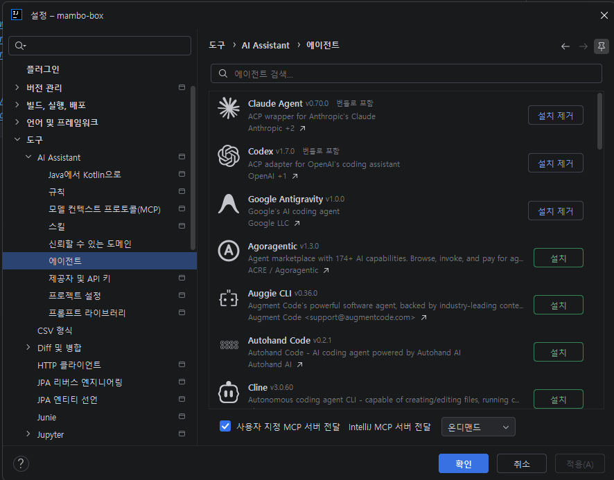

# Agentic Development Environment (ADE)

AI 에이전트의 자율 작업(코드 작성, 빌드, 테스트, 디버깅)과 멀티 에이전트 오케스트레이션을 지원하는 차세대 개발 환경

## ADE
- [Orca](https://www.onorca.dev/): 워크트리 격리, 자율 에이전트 디스패치 및 내장 브라우저 자동화 플랫폼
- [Paseo](https://paseo.sh/): 워크스페이스 관리, 에이전트 위원회 및 작업 핸드오프 프레임워크
- [OmO (Oh My OpenAgent)](https://ohmyopenagent.com/): 다중 서브에이전트(Sisyphus, Prometheus, Explore, Oracle) 분업 오케스트레이션 하네스

## Extensions
- [Claude Agent](https://www.jetbrains.com/help/ai-assistant/claude-agent.html): JetBrains IDE 연동 Claude 코딩 에이전트 확장
- [Codex](https://marketplace.visualstudio.com/items?itemName=openai.chatgpt): VS Code 및 IDE 연동 OpenAI 코딩 에이전트 확장
- [Antigravity](https://antigravity.google/docs/ide/extensions/jetbrains/): IDE 에이전트 확장 및 도구 통합 개발 환경

## Terminal
- [cmux](https://cmux.com/): 에이전트 전용 알림 링, 서브에이전트 패널 분할, 내장 브라우저를 지원하는 AI-Native 터미널 멀티플렉서
- [tmux](https://github.com/tmux/tmux): 세션 유지 및 터미널 윈도우/패널 분할 도구
- [Zellij](https://zellij.dev/): 플러그인 시스템을 갖춘 Rust 기반 터미널 작업공간 및 멀티플렉서 도구
- [Herdr](https://herdr.dev/): 에이전트 상태(작업/입력대기/완료) 추적 및 세션 오케스트레이션을 지원하는 AI-Native 터미널 멀티플렉서
