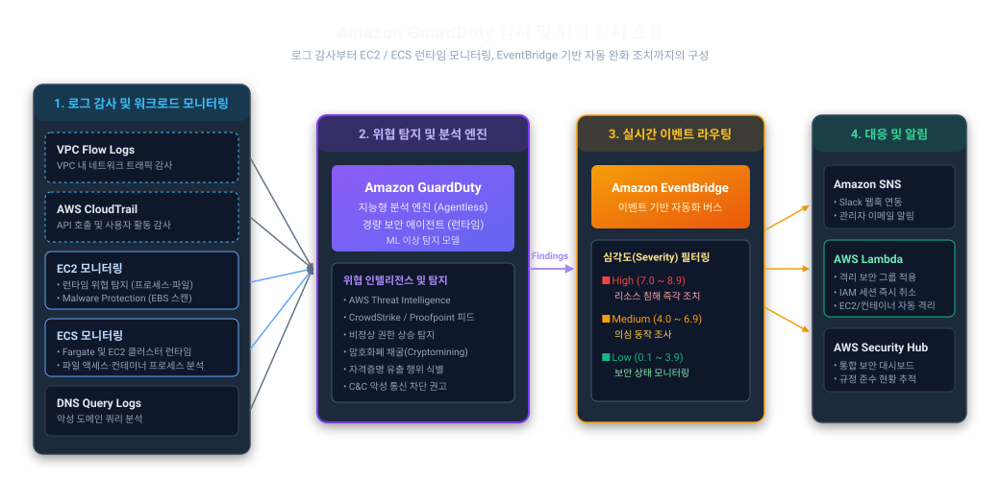

# Amazon GuardDuty

AWS Flow Logs와 CloudTrail 등의 다양한 로그로 비정상적인 활동 감지

- [Amazon GuardDuty Documentation](https://docs.aws.amazon.com/guardduty/)

## 사전 설정

- [Logging IP traffic using VPC Flow Logs](https://docs.aws.amazon.com/vpc/latest/userguide/flow-logs.html): VPC 내 트래픽 감사
- [AWS CloudTrail](https://docs.aws.amazon.com/awscloudtrail/latest/userguide/cloudtrail-user-guide.html): AWS 계정 내 API 호출 및 사용자 활동 감사
- [DNS Query Logs](https://docs.aws.amazon.com/Route53/latest/DeveloperGuide/query-logs.html): VPC 내 도메인 쿼리 감사
- EC2 및 ECS 런타임 모니터링: 호스트 및 컨테이너(Fargate 포함) 내 프로세스 실행·파일 무결성 분석
  - EC2 런타임 모니터링 구성 시 대상 인스턴스에 [GuardDuty 보안 에이전트 수동 설치](https://docs.aws.amazon.com/ko_kr/guardduty/latest/ug/managing-gdu-agent-ec2-manually.html) 및 통신을 위한 [Amazon VPC 엔드포인트 수동 생성](https://docs.aws.amazon.com/ko_kr/guardduty/latest/ug/managing-gdu-agent-ec2-manually.html#creating-vpc-endpoint-ec2-agent-manually) 필요
- 디텍터 활성화 시 IAM 서비스 연결 역할(`AWSServiceRoleForAmazonGuardDuty`) 자동 생성
- 멀티 계정 환경 구성 시 AWS Organizations 내 위임 관리자(Delegated Admin) 계정 지정 권장

## 감사 흐름 구성도



- 데이터 소스: VPC Flow Logs, CloudTrail, EC2·ECS 런타임 모니터링, DNS 쿼리 로그 수집
- 위협 분석: 머신러닝 이상 탐지 및 위협 인텔리전스(AWS Threat Intelligence 등) 기반 분석
- 자동화 대응: EventBridge 기반 심각도(High/Medium/Low) 필터링 후 SNS 알림 및 Lambda 자동 완화 조치 수행

## 위협 탐지 결과(Findings) 예시

IAM 임시 자격증명 유출 및 비정상 API 탐색 행위 탐지 사례 (민감 정보 마스킹)

- **위협 유형**: `UnauthorizedAccess:IAMUser/InstanceCredentialExfiltration.OutsideAWS`
- **심각도**: High (8.0)
- **대상 리소스**: IAM Role `[ROLE-NAME]` (AssumedRole: `AROAXXXXXXXXXXXXXXXXX:i-0123456789abcdef0`)
- **발생 위치**: 외부 네트워크 IP `198.51.100.xxx` (미국 / ASN 21928)
- **호출된 비인가 API**:
  - `ssm.amazonaws.com: SendCommand` (AccessDenied)
  - `elasticloadbalancing.amazonaws.com: DescribeTargetGroups` (AccessDenied)
  - `apigateway.amazonaws.com: GetResources, GetRestApis, GetStages, GetRestApi` (AccessDenied)
- **GuardDuty 의심 탐지 사유**:
  - 해당 AWS 계정에서 이전에 사용된 적 없는 User Agent (`Boto3/1.34.46 ... Python/3.12.3`)
  - 해당 AWS 계정에서 이전에 관찰되지 않은 외부 ISP/ASN (`ASN=21928`)

## GuardDuty 보안 에이전트 설치

EC2 런타임 모니터링을 위한 에이전트 설치 방법

- [GuardDuty 보안 에이전트 관리 공식 가이드](https://docs.aws.amazon.com/ko_kr/guardduty/latest/ug/managing-gdu-agent-ec2-manually.html)

### Systems Manager(SSM) 활용

대상 EC2 인스턴스에 SSM 명령(Run Command)을 전송하여 일괄 설치

```sh
# SSM Run Command를 통한 에이전트 설치
aws ssm send-command \
  --document-name "AmazonGuardDuty-ConfigureRuntimeMonitoringSsmPlugin" \
  --targets '[{"Key": "InstanceIds", "Values": ["<instance-id>"]}]' \
  --parameters '{
    "action": ["Install"],
    "installationType": ["Uninstall and reinstall"],
    "name": ["AmazonGuardDuty-RuntimeMonitoringSsmPlugin"],
    "version": [""]
  }'
```

### 수동 설치 (RPM)

```sh
# 에이전트 설치 (Amazon Linux / RHEL 계열)
sudo yum install -y amazon-guardduty-agent

# 서비스 시작 및 부팅 시 자동 실행 등록
sudo systemctl enable --now amazon-guardduty-agent
```

### 설치 상태 및 로그 검증

```sh
# 서비스 동작 상태 확인
sudo systemctl status amazon-guardduty-agent

# 실시간 서비스 저널 로그 확인
sudo journalctl -u amazon-guardduty-agent -f

# 에이전트 로그 파일 확인
ls -la /var/log/amzn-guardduty-agent/
```

## 관련 자료

- [Amazon GuardDuty로 AWS 계정 안전하게 지키기](https://www.youtube.com/watch?v=5_ghqIvIZ1Y)
- [GuardDuty를 이용한 ECS Fargate 및 EC2 런타임 모니터링](https://aws.amazon.com/ko/blogs/tech/guardduty-ecs-runtime-monitoring/)

